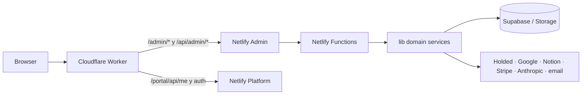

# Robin Admin — guía técnica extendida

> **¿Primera vez en el código?** Empieza por la [USERGUIDE](USERGUIDE.md): contiene el itinerario de incorporación y enlaza los capítulos de runtime, frontend, API, servicios, seguridad y flujos entre repositorios.
>
> Para seguir los datos desde la pantalla hasta el handler, almacenamiento o proveedor, consulta [DATAFLOW](docs/DATAFLOW.md).

## Propósito y límites

Este repositorio mantiene el panel interno de administración que se publica en `https://project-robin.com/admin/`. Incluye su frontend, handlers serverless, adaptadores a proveedores y funciones administrativas de negocio. Comparte el punto de entrada de identidad con Robin Platform; The Robin Plan está desplegado como un servicio hermano independiente.

El proyecto no es un monorepo: Robin Platform y Robin Subscriptions tienen sus propios despliegues, configuración, funciones, credenciales y bases de datos. El código repetido en los repos sigue siendo una copia independiente, no una dependencia npm compartida.

## Runtime de extremo a extremo



En local, `npm run dev` inicia Vite y el servidor Netlify Dev que expone las Functions en el mismo origen. En producción, el Worker de Cloudflare vive en el repo Robin Platform y enruta `/admin/` a este despliegue de Netlify. El detalle normativo está en [CLOUDFLARE_ROUTING.md](docs/CLOUDFLARE_ROUTING.md).

## Frontend

- `src/main.jsx` monta React y los estilos globales.
- `src/App.jsx` resuelve el estado de sesión y muestra login o `AdminApp`.
- `src/components/admin-app.tsx` es el shell autenticado: navegación, permisos por pestaña, cargas de datos y selección de módulos.
- `src/components/feature-modules.tsx` es el registro de vistas lazy-loaded. Las pantallas viven bajo `src/features/admin/` y los dashboards/reportes bajo `src/components/`.
- Los servicios `src/services/portal.ts`, `admin-data.ts`, `integrations.ts` y `web-analytics.ts` mantienen contratos de navegador con `/api/*`; `src/lib/api-path.ts` aplica el prefijo del Worker para identidad compartida.
- `vite.config.mjs` configura React, alias `@`, nonce CSP y chunks de dependencias. `netlify.toml` controla redirects, fallback SPA, headers, edge functions y tareas programadas.

## Backend y persistencia

`netlify/functions/` mantiene la frontera HTTP: valida método, petición, sesión y autorización antes de delegar. `lib/` agrupa lógica reutilizable: autenticación/autorización, CRM, pagos, finanzas, documentos, calendario, correo, integraciones, analítica y configuración operativa. Los servicios Supabase usan secretos del servidor; el frontend no recibe service-role keys. Las subidas de archivos usan tickets o URLs firmadas para reducir exposición de credenciales.

Los SQL versionados están bajo `supabase/migrations/`, `supabase/admin-migrations/` y `supabase/robin-plan-migrations/`; estos directorios corresponden a ámbitos distintos. No ejecutar una migración solo por existir en el repo: revisar destino, consumidores, permisos y plan de reversión.

## Funcionalidades principales

1. **CRM**: normaliza leads, controla etapa, propietario, notas, llamadas, futuros cursos, campañas y correo. La UI está en `src/features/admin/leads.tsx`, `lead-inbox.tsx` y `email-composer.tsx`; la traducción de registros vive en `src/services/admin-data.ts`; los handlers empiezan por `admin-crm-*`.
2. **Dashboard e informes**: une métricas de leads/clientes con datos de finanzas y pagos. Composición en `dashboard-home.tsx` y `dashboard-report.tsx`; cálculos auxiliares en `dashboard-utils.ts`.
3. **Finanzas y ventas**: `lib/finance-dashboard.js` y `lib/sales-dashboard.js` son fachadas de dominio; los módulos detallados están en `lib/finance/` y `lib/holded/`. No cambiar contratos de los handlers de dashboard sin revisar sus tipos de frontend.
4. **Analítica web**: orquestación y pestañas en `src/components/web-analytics*`; cliente en `src/services/web-analytics.ts`; ingesta y consulta en `web-collect`, `admin-web-*` y servicios de Google/almacenamiento.
5. **Administración, alumnos e integraciones**: el shell aplica permisos, y módulos en `src/features/admin/` exponen acciones apoyadas por handlers bajo `admin-*`.

Consulta la [guía por flujo](USERGUIDE.md) y el [inventario de rutas](docs/API_INVENTORY.md) para trazar una acción de UI hasta el servicio y la tabla/proveedor.

## Seguridad

- Sesiones y permisos se verifican en servidor; la visibilidad de una pestaña en UI no sustituye autorización de Function.
- Claves privadas: solo variables de entorno de Netlify/servidor; `.env.example` es el contrato de nombres, no debe contener secretos.
- Datos personales y financieros: no imprimir payloads completos; usar logs estructurados y redacción del módulo `lib/observability.js`.
- CSP incluye nonce de build (`robin-vite`), cabeceras de seguridad, `no-store` para APIs y caché inmutable para assets. Un cambio de Vite o Cloudflare debe comprobar nonce, rutas `/admin/assets/*` y versión de HTML.

## Comandos y mantenimiento

```bash
npm ci
npx netlify dev          # Vite + Functions local
npm run build            # bundle de producción
npm test                 # pruebas del repo Admin
npm run docs:generate    # actualizar árbol, mapa y API inventariada
npm run docs:check       # verificar que el material generado está actualizado
```

Los dos últimos comandos se añaden con esta documentación. El mapa generado es un índice navegable; las guías de dominio explican relaciones y contratos que no se pueden deducir solo por nombres de archivo.

## Repos conectados

- [Robin Platform — READMELONG](https://github.com/RobinManuV/Robin-platform-cliente/blob/main/READMELONG.md), [USERGUIDE](https://github.com/RobinManuV/Robin-platform-cliente/blob/main/USERGUIDE.md), [enrutamiento](https://github.com/RobinManuV/Robin-platform-cliente/blob/main/docs/CLOUDFLARE_ROUTING.md).
- [Robin Subscriptions — READMELONG](https://github.com/saantimartinn/robin-subscriptions/blob/main/READMELONG.md), [USERGUIDE](https://github.com/saantimartinn/robin-subscriptions/blob/main/USERGUIDE.md), [arquitectura](https://github.com/saantimartinn/robin-subscriptions/blob/main/docs/ARCHITECTURE.md).

El mapa global de hostnames, prefijos de URL y despliegues está documentado en cada `docs/CLOUDFLARE_ROUTING.md`; Robin Platform contiene la referencia principal del Worker.
