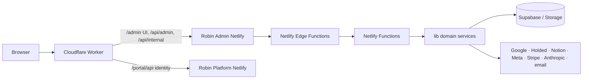

# Arquitectura de Robin Admin

## Resumen

Aplicación web de administración desplegada en Netlify: SPA React/Vite, Functions Node para `/api/*`, Edge Functions para límites de tráfico y librerías de dominio en `lib/`. Cloudflare aporta el hostname público y el proxy por prefijos; su Worker está versionado en [Robin Platform](https://github.com/RobinManuV/Robin-platform-cliente/blob/main/infrastructure/cloudflare/project-robin-router.js).

## Capas y dependencias

| Capa | Directorio/archivo | Dirección de dependencia |
|---|---|---|
| Build y hosting | `vite.config.mjs`, `netlify.toml`, `package.json` | Define salida `dist`, rutas, cabeceras, functions y schedules. |
| Navegador | `src/main.jsx`, `src/App.jsx`, `src/components/` | Usa componentes y clientes `src/services/`; no usa secretos de backend. |
| Funcionalidades | `src/features/admin/` | Se cargan desde `feature-modules.tsx`; reciben acciones y datos desde `AdminApp`. |
| API cliente | `src/services/`, `src/lib/api-path.ts` | Llama a `/api/*` con cookies same-origin y traduce respuestas a tipos de UI. |
| Límite HTTP | `netlify/functions/` | Comprueba método, origen, sesión, rol y entrada; delega en `lib/`. |
| Límite Edge | `netlify/edge-functions/` | Rechaza o limita solicitudes antes de Functions según configuración Netlify. |
| Dominio/adaptadores | `lib/` | Reglas reutilizables, Supabase, proveedores, PDF y observabilidad. |
| Estructura SQL | `supabase/*/` | Migraciones separadas por proyecto/esquema de destino. |

El detalle de navegación está en [USERGUIDE](../USERGUIDE.md); [FILE_MAP](FILE_MAP.md) describe a mano módulos, contratos y recorridos. El [índice generado](FILE_INDEX.generated.md) y el árbol enlazan los archivos fuente.

## Mapa de carpetas

| Carpeta | Contenido |
|---|---|
| `src/components/` | Shell, navegación, tablas, dashboards, analítica web y primitivas UI. |
| `src/features/admin/` | CRM, bandeja, alumnos, settings, analytics, correo y componentes comunes de features. |
| `src/services/` | Clientes HTTP/typed de portal, CRM, integraciones y web analytics. |
| `src/lib/`, `src/types/`, `src/data/` | Helpers de path/permisos, modelos TypeScript y catálogos del navegador. |
| `src/styles/`, `public/` | CSS global y recursos estáticos. |
| `netlify/functions/`, `netlify/edge-functions/` | Entrypoints de API/jobs y middleware previo al handler. |
| `lib/finance/`, `lib/holded/`, `lib/` | Agregadores por dominio/proveedor y servicios de backend más generales. |
| `supabase/migrations/`, `supabase/admin-migrations/`, `supabase/robin-plan-migrations/` | SQL versionado por ámbito; no asumir que las tres carpetas van al mismo proyecto. |
| `tests/`, `scripts/` | Pruebas Node y tareas de histórico CRM/documentación. |
| `docs/`, `.github/` | Guías mantenidas, inventario generado y automatización GitHub. |

El [árbol de carpetas y archivos](codebase/README.md) incluye carpetas internas, imágenes, configuración y cada archivo enlazado al source.

## Estado y datos

- `src/App.jsx` resuelve sesión mediante `portalClient.me()` y el login compartido. Cuando existe sesión monta `AdminApp`.
- `admin-app.tsx` interpreta la ruta `/admin` como prefijo de despliegue y resuelve la sección interna, permisos visibles y carga de vistas.
- Cada llamada administrativa sensible vuelve a comprobar identidad y rol en backend. La lista de pestañas es una regla de navegación, no una barrera de seguridad.
- `lib/supabase.js`, `admin-supabase.js` y módulos de dominio encapsulan acceso al almacenamiento y datos. El navegador solo recibe respuestas autorizadas o enlaces firmados.
- `lib/finance-dashboard.js` y `lib/holded.js` actúan como fachadas de compatibilidad sobre módulos especializados.

## Dominios

1. **Identidad y permisos**: `lib/auth.js`, `lib/admin-auth.js`, `lib/authorization.js`, `lib/admins.js`, `lib/admin-profiles.js`, `src/lib/admin-permissions.ts` y APIs compartidas del portal cliente.
2. **CRM**: clientes de `src/services/admin-data.ts`, UI bajo `src/features/admin/`, handlers `admin-crm-*`, funciones `lib/crm-*`, importación histórica y webhooks Notion/website/Meta.
3. **Dashboard y reporting**: `src/components/dashboard-*`, `src/services/portal.ts` e `integrations.ts`, endpoints de resumen de admin y snapshots.
4. **Finanzas/ventas**: `lib/finance/`, `lib/holded/`, `lib/sales-dashboard.js`, endpoints `admin-finance-dashboard`, `admin-sales-dashboard`, `admin-holded-snapshot` y sus tipos de UI.
5. **Portal de aplicación**: `profile`, onboarding, documentos, payments, careers, bookings, notifications y chat; una parte de la identidad/cliente vive en Robin Platform.
6. **Analítica web**: cliente `web-analytics.ts`, componentes de tabs y handlers `web-collect`, `admin-web-*`.

## Runtime de desarrollo y despliegue

- `npx netlify dev` inicia el proyecto en `http://localhost:8888` y conecta Vite con Functions.
- `npm run build` crea el SPA en `dist/`; el directorio publicado no contiene el código fuente del servidor.
- Netlify atiende rutas API a partir de redirects en `netlify.toml`; el fallback SPA entrega `index.html` para navegación de navegador.
- Cloudflare conserva WordPress como fallback y proxifica prefijos de producto. El Worker reescribe las referencias `/assets/*` del HTML de Admin a `/admin/assets/*` y añade el parámetro de caché configurado.
- El HTML de Admin usa nonce CSP `robin-vite`; cambios en plantilla o build deben mantener `html.cspNonce`, encabezado CSP y atributos `nonce` alineados.

## Repositorios vecinos

| Repositorio | Responsabilidad | Enlace técnico |
|---|---|---|
| Robin Platform cliente | Portal de alumnos, administración de aplicación, funciones de negocio e identidad principal. | [README largo](https://github.com/RobinManuV/Robin-platform-cliente/blob/main/READMELONG.md) · [arquitectura](https://github.com/RobinManuV/Robin-platform-cliente/blob/main/docs/ARCHITECTURE.md). |
| Robin Subscriptions | The Robin Plan con su propia sesión, esquema y cuenta Supabase. | [README largo](https://github.com/saantimartinn/robin-subscriptions/blob/main/READMELONG.md) · [arquitectura](https://github.com/saantimartinn/robin-subscriptions/blob/main/docs/ARCHITECTURE.md). |

No existe paquete compartido ni despliegue atómico entre repos. Los contratos compartidos deben evolucionar de forma compatible y coordinarse por cambios en cada proyecto.
